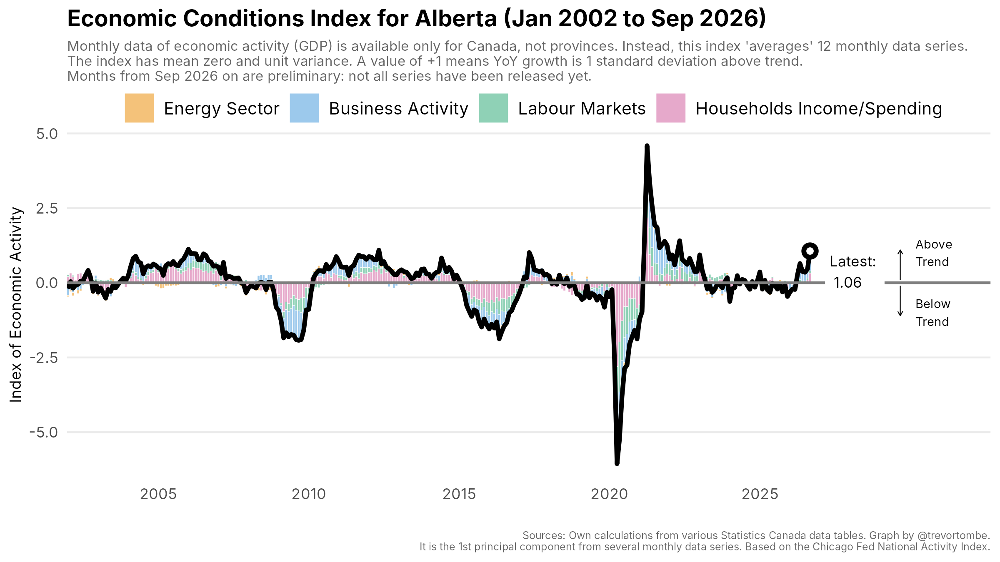
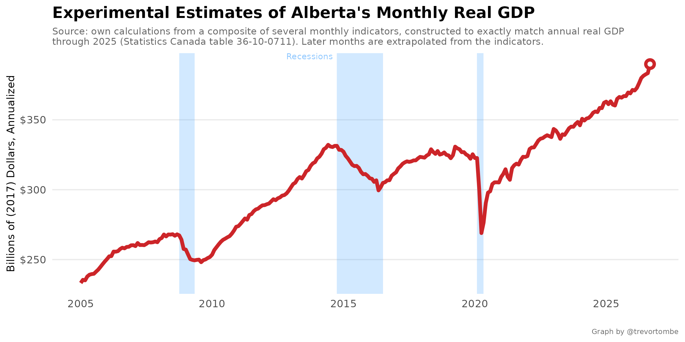

# Monthly Index of Economic Conditions in Alberta

This repository compiles monthly data from a variety of Statistics Canada sources to estimate real-time economic conditions in Alberta. It closely follows, as much as the data allows, the Chicago Fed National Activity Index: <https://www.chicagofed.org/publications/cfnai/index>

For comparison, the Government of Alberta maintains a separate "Alberta Activity Index": <https://www.alberta.ca/alberta-activity-index>.

## Contents of the repository

- `AlbertaData.R` downloads only the series the index uses, in a single request to Statistics Canada's Web Data Service.
- `AlbertaECI.R` estimates the index (the first principal component of year-over-year changes in 12 monthly indicators), draws the figures, and produces experimental monthly real GDP estimates benchmarked to annual GDP from table 36-10-0711.
- `Data/ECI_Index_Data.csv` is the index and its components; `Data/Monthly_GDP_Estimates.csv` is the monthly real GDP series. Earlier releases are kept in `Data/vintages/`.

Recent months are published once at least half of the index weight has been released; those months are flagged as preliminary and will be revised as the remaining data arrive.

The latest ECI for Sep 2026 is 0.91 (preliminary: not all series have been released for this month). The full time series since Jan 2002 is plotted below:

------------------------------------------------------------------------

The index was last updated on November 25, 2026 at 17:39 CST.
